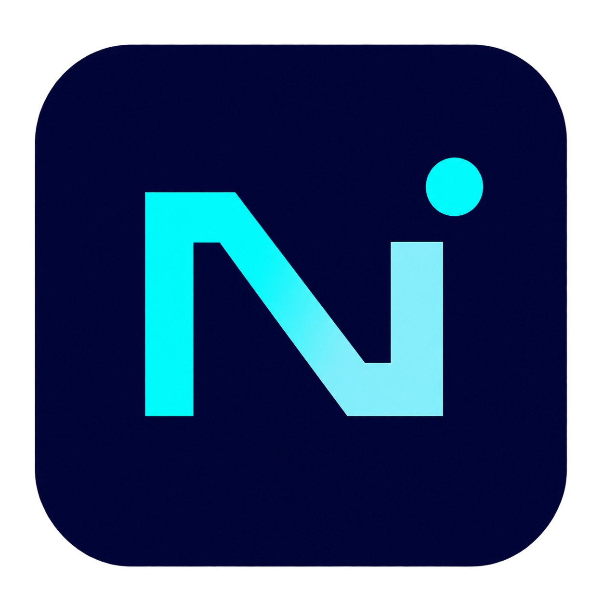
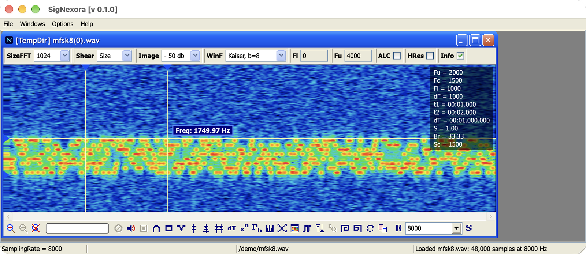
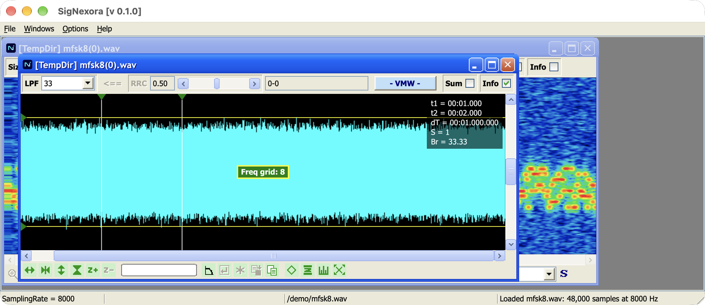
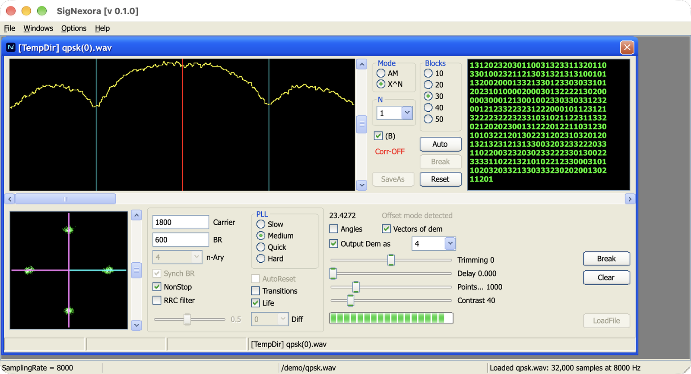
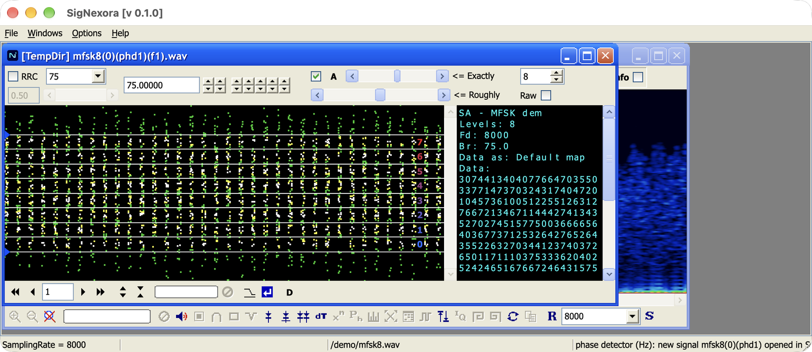
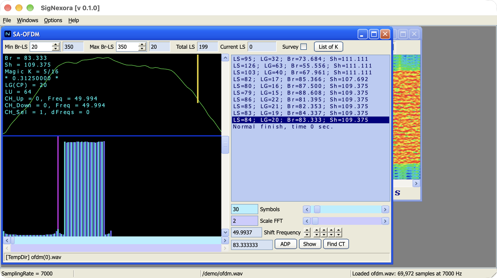

# SigNexora



**SigNexora — signal intelligence tool.**

SigNexora is a cross-platform, open-source tool for offline radio-signal analysis, visualization, measurement, demodulation, and signal generation. Written in Rust with a GPUI desktop interface, it supports Windows, macOS, and Linux visual styles.

You can open recordings of any size (WAV, RF64, SigMF, raw, MP3/FLAC), view them as a sonogram and waveform with SA-style markers and readouts, edit them with every SA editing tool (filters, shifts, inversions, resampling and more), save the results, and measure keying rates and carriers precisely (AM and modified-AM detectors, phase detector, power-of-N, ACF/CCF, line measurement to fractions of a hertz, automatic baud estimation), and examine tones and structure (value histograms, Count freqs, VMW raster, FSK resynthesis), and work PSK/QAM signals in PhasePlane (carrier and clock loops, constellation, angles, codes) with the ISD corrector (blind adaptive equalizer), demodulate FSK/MFSK up to 256 levels (including APCO-25 C4FM), analyse OFDM (correlation triangle, precise symbol rate, channels in models A/B/C, List of K and native-rate resampling), save and replay sessions, export reports and script analyses in Rhai. A built-in OCG-style signal generator (File > Signal generator (OCG)..., or `sn-cli generate`) makes test signals with exactly known parameters: tones, noise, FSK/MFSK/MSK/GMSK, PSK and QAM up to QAM-256 with RC/RRC pulses, C4FM and OFDM in models A/B/C with pilots, through a channel with frequency offset and drift, multipath, clock offset, noise and clipping; it includes OCG's OFDM-with-CP calculators and List of K, and generated signals replay exactly from a saved session. The interface is available in English, French, Spanish, German, Portuguese, Ukrainian, Russian, Japanese and Korean, with seventeen colour themes (the default, Classic (SA), reproduces SA on Windows 95; the others include two high-contrast and two colour-blind safe ones, and red night-vision, green phosphor and amber single-hue themes) and keyboard shortcuts for the main actions (Help > Use help...).

The user interface reproduces SA 6.2.6.7's: the main window is an MDI frame with SA's menu (`File`, `Windows`, `Options`, `Help`) and status bar (`SamplingRate = 8000` and the source file path). Every signal and result is a child window inside it, titled like SA's (`[TempDir] test(0)(c1)(phd1).wav`); almost every operation opens its result in a new window offset from the one it was started in, and closing a window is the undo. The sonogram window has SA's top toolbar (`SizeFFT`, `Shear`, `Image`, `WinF`, `Fl`, `Fu`, `ALC`, `HRes`, `Info`), its bottom toolbar of tools with SA's glyphs and hints, its right-click popup menu, the Info overlay, floating result boxes and the Correction of BR panel. See `docs/SA_UI_SPEC.md` for the original UI and what SigNexora implements of it.

## Screenshots

Classic theme, the default. Each picture is the application window; the empty workspace under the child window is left out. The recordings are generated demos.



*Sonogram of an MFSK-8 recording, with markers and the Info overlay.*



*Waveform of the same recording, with a frequency grid.*



*PhasePlane on a QPSK recording: spectrum, constellation and demodulated symbols.*



*FSK demodulator on the phase-detector output, eight levels.*



*OFDM analysis of the `ofdm_lu64_lg20_7000` preset: correlation, symbol rate and List of K.*

## Build and run

Requires Rust 1.95 or newer. The desktop package is `sn-gui` and its executable is `signexora`. The CLI package and executable are `sn-cli`. Existing settings and saved sessions remain compatible with SA-RS.

```
cargo run -p sn-gui                                                # desktop app (the signexora program)
cargo run -p sn-gui -- recording.wav                               # open a file directly
cargo run -p sn-cli -- synth psk --order 4 --baud 2400 -o x.wav    # quick test signal
cargo run -p sn-cli -- generate --list-presets                     # OCG-style generator presets
cargo run -p sn-cli -- generate --preset ofdm_lu64_lg20_7000 -o ofdm.wav
cargo run -p sn-cli -- generate --kind fsk --print-spec > spec.json   # dump a spec to edit
cargo run -p sn-cli -- generate --spec spec.json -o fsk.wav        # .sigmf-meta for I/Q or fractional rates
cargo run -p sn-cli -- info x.wav
cargo run --release -p sn-cli -- bench x.wav                       # time viewer work on a file
cargo run -p sn-cli -- peaks x.wav                                 # strongest spectral components
cargo run -p sn-cli -- adp x.wav                                   # automatic baud-rate estimate
cargo run -p sn-cli -- measure x.wav --lo 20 --hi 300 \
    --edit '{"op":"modified_am"}'                                # clock line after a detector
cargo run -p sn-cli -- process x.wav -o y.wav \
    --edit '{"op":"band_select","lo":400,"hi":1300}' \
    --edit '{"op":"resample","rate":2000}'                         # scripted edit chain
cargo run -p sn-cli -- ofdm ofdm.wav --min-br 40 --max-br 120   # OFDM: CT, Br, channels, List of K
cargo run -p sn-cli -- script chain.rhai --session s.json          # run a Rhai script, save it as a session
cargo run -p sn-cli -- replay s.json                               # rebuild every signal of a session
cargo run -p sn-cli -- session-report s.json --html r.html --md r.md   # analysis report
```

On macOS, `scripts/bundle-macos.sh` creates `target/release/SigNexora.app` with the app name and icon for Finder and the Dock. The Dock icon also works with `cargo run`. These local bundles are ad-hoc signed, not notarized for distribution.

Logo and platform icon assets are in [`crates/sn-gui/assets/branding`](crates/sn-gui/assets/branding). Run `scripts/icons.sh` on macOS to regenerate the icon exports from the PNG master.

Push a tag named `v` plus the workspace version in `Cargo.toml` (`v0.1.0`) to publish a GitHub release. That tag builds `signexora` and `sn-cli` for Linux, macOS, and Windows and attaches the archives to the tag. The macOS archive is a disk image, `signexora-<tag>-macos-<arch>.dmg`, containing `SigNexora.app` and `sn-cli`. The app icon is `signexora.icns` inside the bundle (`CFBundleIconFile`). The app is the release build from `scripts/bundle-macos.sh`, ad-hoc signed.

A generator spec is JSON with a `"kind"` (`tones`, `noise`, `fsk`, `linear`, `c4fm`, `ofdm`), the fields of that kind and a `common` block (label, sample rate, length in seconds or symbols, seed, centre frequency and the channel). `--print-spec` with `--kind`, `--preset` or `--spec` prints one to start from, and `--seed N` replaces the seed:

```
{
  "kind": "linear",
  "common": {
    "label": "", "sample_rate": 8000.0, "length": { "seconds": 10.0 }, "seed": 1,
    "center_frequency": 0.0,
    "channel": { "noise": { "snr": { "db": 20.0, "bandwidth": null } } }
  },
  "constellation": "qam16", "baud": 1200.0, "carrier": 1800.0, "amplitude": 0.3,
  "shaping": { "root_raised_cosine": { "alpha": 0.35 } },
  "differential": false, "complex": false
}
```

A script works on signal handles and records everything it does, so the session it saves replays bit for bit:

```
let s = open("x.wav");                                    // relative to the script's directory
let b = edit(s, #{op: "band_select", lo: 400, hi: 1300}); // any edit, as a map or JSON text
let c = edit(b, `{"op":"resample","rate":2000}`);
print(adp(c)[0].baud);                                    // also: measure_line(c, lo, hi), info(c)
save_wav(c, "y.wav");                                     // or save_sigmf(c, "y", "description")
```

## Development

```
cargo fmt --all          # format
cargo lint               # clippy, warnings are errors
cargo lintfix            # apply clippy's automatic fixes
scripts/check.sh         # everything CI runs (format, lint, tests, doc tests)
scripts/deps.sh          # cargo audit + cargo deny (vulnerabilities, licences, sources)
scripts/fuzz.sh          # libFuzzer, 60 s per target (needs nightly + cargo-fuzz)
scripts/fuzz.sh edit 600 # one target for 600 s
```

Git hooks come from cargo-husky with its default features. The first `cargo test` installs
a `pre-push` hook that runs `cargo test --all`. Install the tools once with
`cargo install --locked cargo-audit cargo-deny cargo-fuzz` and `rustup toolchain install nightly`.

Benchmarks: `sn-io`, `sn-dsp`, `sn-analysis`, `sn-demod` and `sn-ofdm` each have a
`benches/perf.rs` that times the hot paths on realistic sizes (10-60 s at 48 kHz, 2 s of
8 MS/s I/Q, wideband OFDM) with the release profile and prints the fastest and the median wall
time per case. Run `cargo bench -p sn-dsp --bench perf`, or add a filter to run only the
matching cases (`cargo bench -p sn-analysis --bench perf -- measure_line`). They need no extra
dependencies. Close other heavy programs first: other builds running at the same time skew the
numbers. Parallel loops use rayon's global pool; `RAYON_NUM_THREADS=1` gives single-thread
figures for comparison.

## Crates

| Crate | Role |
|---|---|
| `sn-core` | Signals, derived-signal graph, measurement context, jobs |
| `sn-io` | File loaders (memory-mapped) and writers |
| `sn-synth` | Test-signal generator |
| `sn-cli` | Headless command-line tool |
| `sn-ui-core` | User-interface logic shared by the front end: translations, settings, titles, window state |
| `sn-gui` | Desktop application `signexora` (GPUI, Windows, macOS and Linux styles) |
| `sn-dsp` | Windows, spectra, sonogram columns, overviews |
| `sn-analysis` | Line-frequency measurement, automatic baud estimation, histograms, tone grids, raster |
| `sn-demod` | PhasePlane (PSK/QAM) and the universal FSK/MFSK demodulator |
| `sn-session` | Saved sessions, replay, Markdown and HTML analysis reports |
| `sn-ofdm` | OFDM analysis: Find CT, Get Br, channel grid, List of K |
| `sn-script` | Rhai scripting over the operation API |
